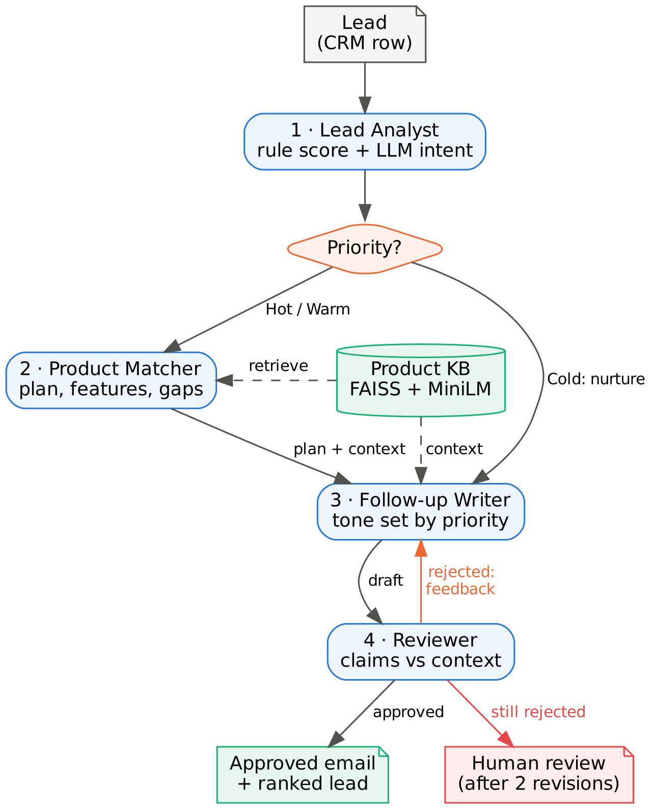
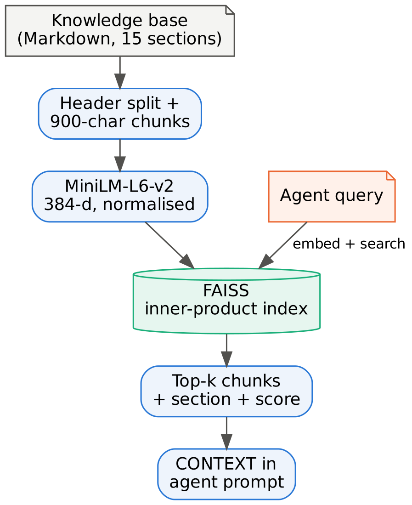
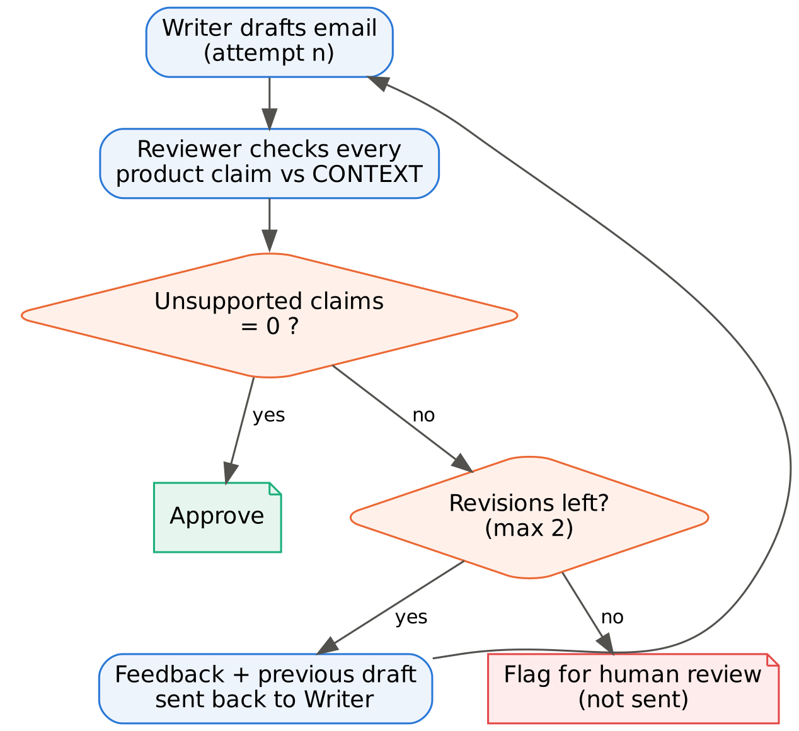
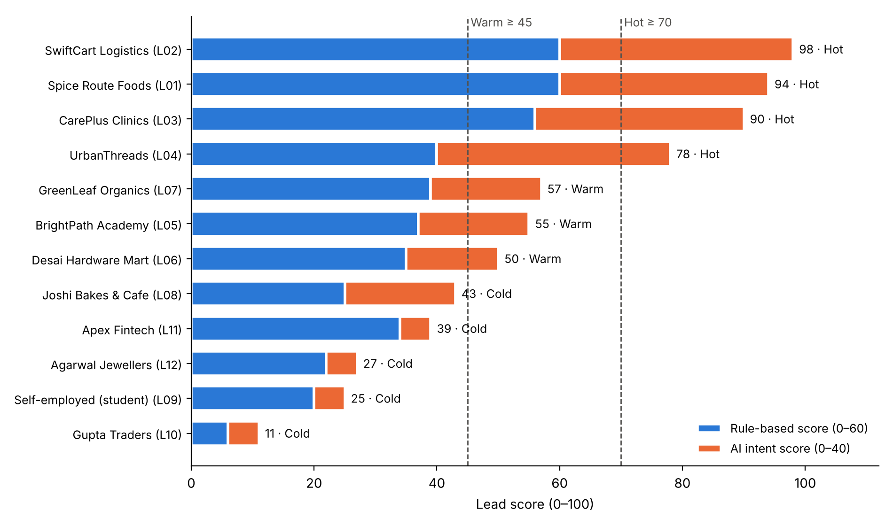

# Agentic Sales Lead Analysis & Follow-Up (RAG)

**A four-agent system that prioritises B2B sales leads and writes follow-up emails in which every product claim is checked against the company's own documentation before it goes out.**

[](https://colab.research.google.com/github/Jagath30/Agentic-sales-lead-rag/blob/main/agentic_sales_lead_rag.ipynb)


---

## The problem

Sales teams lose time in two places:

1. **Choosing whom to call first.** Scores built from CRM fields (budget, clicks, recency) miss what matters most, which is usually written in the salesperson's notes: *"verbally agreed to buy"*, *"locked into a competitor until 2028"*.
2. **Writing the follow-up.** Emails are generic, or, when an LLM writes them, they confidently promise features, discounts and certifications the product doesn't have.

This project tackles both in one pipeline, and measures each part instead of assuming it works.

## What it does

For every lead in a CRM export, four agents cooperate:

| # | Agent | Decides | Tools / input | Structured output |
|---|---|---|---|---|
| 1 | **Lead Analyst** | How promising the lead is: **Hot / Warm / Cold** | `rule_based_score` tool on CRM fields (0–60) + LLM reading of the notes for buying intent (0–40) | `IntentAssessment` |
| 2 | **Product Matcher** | Which plan fits, which features matter, and what **cannot** be offered | `search_product_kb` tool (FAISS retrieval) | `ProductMatch` |
| 3 | **Follow-up Writer** | What to say, in a tone set by priority | Retrieved context, plan, gaps, Reviewer feedback | `FollowUpEmail` |
| 4 | **Reviewer** | Whether every product claim is supported | Retrieved context only | `ReviewVerdict` |

<p align="center">
  
</p>

**Run-time decisions** that make it agentic rather than a fixed chain:

- **Routing:** the priority picks the path. Cold leads skip the Product Matcher and get a short nurture email.
- **Self-correction:** the Reviewer sends rejected drafts back with specific feedback, up to 2 revisions.
- **Escalation:** an email still ungrounded after 2 revisions is flagged for **human review** and never sent automatically.

## How it works

### 1. Hybrid lead scoring

The score is split so that every decision can be explained:

| Part | Source | Points |
|---|---|---|
| Budget fit | CRM field, rule-based | 0–20 |
| Company size | CRM field, rule-based | 0–10 |
| Recency of contact | CRM field, rule-based | 0–15 |
| Engagement (demo, pricing visits, opens) | CRM field, rule-based | 0–15 |
| **Buying intent** | **LLM reading of stated need + notes**, against a 4-band rubric | 0–40 |

A total of **≥ 70 is Hot**, **≥ 45 is Warm**, and anything lower is **Cold**. The LLM's score is clamped to its range, and it has to return the buying signals and risks it based the score on.

### 2. Retrieval-augmented generation

The product knowledge base is split on its Markdown headings (one chunk per section), embedded with `all-MiniLM-L6-v2` (384-d, normalised) and indexed in **FAISS** with inner product, which is cosine similarity on normalised vectors. The Product Matcher searches it three times: once for the lead's need, once for the plans (to weigh budget) and once for a case study from a similar industry. It then lists the **gaps** it finds, so the Writer is honest about them.

<p align="center"></p>

### 3. Write → review → revise

Every agent is an LCEL chain, `prompt | llm.with_structured_output(Schema)`, so the orchestrator branches on typed fields such as `approved` and `intent_score` instead of parsing free text. The Reviewer sees only the email and the evidence. A draft passes only if the model approves it **and** its list of unsupported claims is empty.

<p align="center"></p>

## Results

These figures come from the recorded run in the notebook (`gpt-oss-120b` via Groq, 12 synthetic leads whose ground-truth labels are hidden from the agents).

| What was measured | How | Result |
|---|---|---|
| Priority accuracy | Against the hidden labels, compared with the same rules without the LLM | **92%** (11/12) vs **75%** rules-only |
| Retrieval quality | 10 questions with known answer sections | **Hit@4 100%**, **MRR 0.90** |
| Grounded emails | Approved by the Reviewer | **42%** on the first draft → **100%** after the loop |
| Guardrail | Email planted with 3 false claims | **3/3 caught**; escalated to a human (see below) |

<p align="center"></p>

Reading the notes corrected the leads that the CRM numbers got wrong. **UrbanThreads** has weak engagement numbers but verbally agreed to buy, and moved from Warm to **Hot**. **Apex Fintech** has a ₹50,000 budget but is locked into a competitor's three-year contract, and moved from Warm to **Cold**. The one miss (Joshi Bakes, 43 against a threshold of 45) was a borderline case.

The Reviewer's rejections were real problems: an invented go-live timeline, a case study described with the wrong industry, and an unverifiable budget claim.

### Guardrail test, and what it revealed

A draft for a clinic chain was planted with three false claims: HIPAA certification, on-premise installation and "3 months free". The Reviewer rejected **all three**. The *automatic repair* still failed. The Writer's honest correction ("we're not HIPAA certified; data is hosted in India") was rejected too, because the security section had never been retrieved for that lead. The clinic asked about HIPAA in its **notes**, and the Matcher only searches on the **stated need**. The email was escalated to a human instead of being sent.

The lesson is that **a verifier is only as good as the context it is given.** The fix is listed under the roadmap below.

## Example: a new lead, live

Trace (abridged) and an excerpt of the approved email:

```text
━━━ NEW · Tandoor Tales Restaurants (Restaurants (8 outlets)) ━━━
[1] Lead Analyst     → rule score 60/60 + intent 28/40 = 88/100 → HOT
    ↳ route: Hot → Product Matcher
[2] Product Matcher  → searched the KB 3 times, 6 chunks
    plan: Growth | features: ['Tally Prime integration', 'Zoho Books integration',
                              'Scheduled reports via WhatsApp', 'Hourly data refresh']
    gaps: ['No native iOS app (iPhone) – only Android app and mobile-friendly web']
[3] Writer           → draft 1: "Ready to launch outlet-wise dashboards for Tandoor Tales"
[4] Reviewer         → ✓ approved: every product claim is supported by the knowledge base
    done in 30.3s, 4 new LLM calls
```

> Great news – the Growth plan covers everything you need. It integrates Tally Prime and Zoho Books, refreshes data hourly, and can push daily sales and food-cost dashboards to WhatsApp. At ₹14,999 per month it fits comfortably within your INR 15,000 budget […] While we don't have a native iOS app yet, the mobile-friendly web portal works flawlessly on iPhone browsers, giving you instant access to the dashboards.

## Quickstart

### Google Colab (easiest)

1. Get a free API key at [console.groq.com](https://console.groq.com) → **API Keys**.
2. Open the notebook in Colab using the badge above.
3. In the **🔑 Secrets** panel, add `GROQ_API_KEY` and switch on *Notebook access*.
4. **Runtime → Run all.**

The first full run takes about 7–10 minutes on Groq's free tier, because the free tier allows 8,000 tokens per minute. Agent responses are cached in `agent_cache.json`, so re-runs take seconds and reproduce the same results.

### Local

```bash
git clone https://github.com/Jagath30/Agentic-sales-lead-rag.git
cd Agentic-sales-lead-rag
python -m venv .venv && source .venv/bin/activate   # Windows: .venv\Scripts\activate
pip install -r requirements.txt
export GROQ_API_KEY="your-key"                      # Windows: set GROQ_API_KEY=your-key
jupyter notebook agentic_sales_lead_rag.ipynb
```

The notebook is self-contained: it writes the knowledge base and leads file itself. Copies of both are in [`data/`](data) so you can browse them.

## Configuration

All the policy settings are in one cell at the top of the notebook:

| Setting | Default | Meaning |
|---|---|---|
| `PROVIDER` | `"groq"` | `"groq"` (`openai/gpt-oss-120b`) or `"gemini"` (`gemini-2.5-flash`, needs `GOOGLE_API_KEY`) |
| `USE_CACHE` | `True` | Re-use saved agent responses for reproducible, free re-runs |
| `HOT_AT`, `WARM_AT` | `70`, `45` | Priority thresholds on the 0–100 score |
| `MAX_REVISIONS` | `2` | Reviewer → Writer rounds before escalating to a human |

## Repository structure

```text
.
├── agentic_sales_lead_rag.ipynb   # the full system: RAG, agents, orchestrator, evaluation, live demo
├── data/
│   ├── brightlane_kb.md           # product knowledge base (fictional company)
│   └── leads.csv                  # 12 synthetic leads with hidden ground-truth priority
├── docs/images/                   # diagrams and charts used in this README
├── requirements.txt
└── LICENSE
```

## Limitations and roadmap

- **Synthetic, small data.** 12 leads and one knowledge base are enough to show the design works, but they are not a production benchmark.
- **LLM variability.** A fresh run can shift intent scores and review outcomes. In an earlier run, first-draft approval was 8% rather than 42%, while priority accuracy and retrieval were unchanged. The cache makes any one run reproducible.
- **The Reviewer makes mistakes both ways.** It rejected some true statements it couldn't verify from the retrieved context, and once let through "daily refresh" described as a Growth feature (Growth refreshes hourly).

Planned next steps:

- [ ] Add a retrieval query on the lead's **notes**, closing the gap the guardrail test exposed.
- [ ] Let the Reviewer **request a targeted retrieval** before rejecting a claim it can't verify.
- [ ] Connect to a real CRM (HubSpot / Zoho) and learn score weights from actual conversions.
- [ ] Evaluate the Reviewer's precision and recall on human-labelled emails.

## Tech stack

LangChain (LCEL, tools, structured output) · Pydantic · FAISS · sentence-transformers (`all-MiniLM-L6-v2`) · Groq (`openai/gpt-oss-120b`) · pandas · matplotlib · Graphviz

## Note on the data

*Brightlane Analytics* and every lead in this repository are fictional, created to test the system against known answers. Any resemblance to real companies or people is coincidental.

## License

[MIT](LICENSE) © 2026 Jagath S Manjunath
